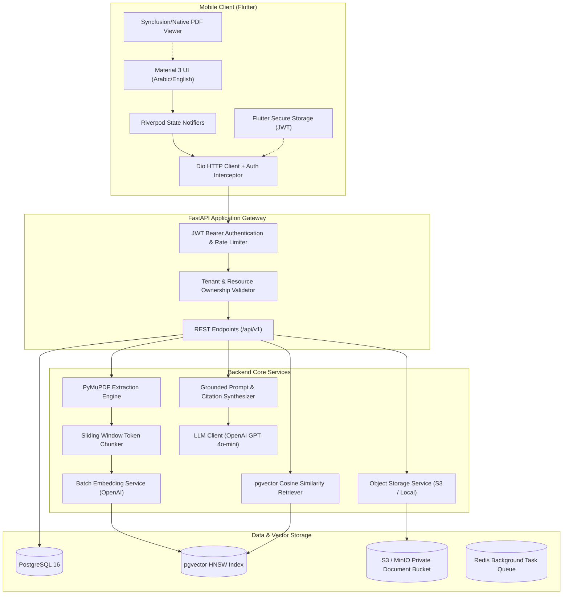
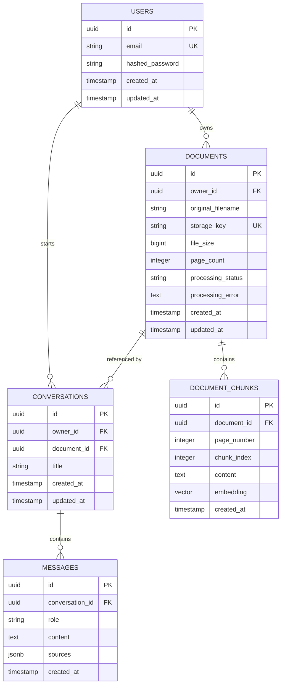

# AI PDF Assistant — Enterprise Full-Stack Mobile & RAG System

[](https://fastapi.tiangolo.com)
[](https://www.python.org/)
[](https://flutter.dev/)
[](https://www.postgresql.org/)
[](https://github.com/pgvector/pgvector)
[](https://pymupdf.readthedocs.io/)
[](https://openai.com/)

**AI PDF Assistant** is a production-oriented, privacy-first mobile & AI system allowing users to ingest dense PDF documents, extract page-indexed text, ask questions in English or Arabic, and receive AI-synthesized answers backed by **verified, clickable page citations** that jump directly to the cited page in the reader.

---

## 🏗️ System Architecture



---

## 📊 Database Schema & Relational Model



---

## 🎯 Grounded RAG & Deterministic Citation Pipeline

### The Problem: Hallucinated Citations
Traditional naive RAG implementations ask the LLM to guess what page an excerpt was on, resulting in fabricated citations and user confusion.

### The Solution: Deterministic Physical Mapping
1. **PyMuPDF Extraction**: During upload, PyMuPDF extracts text page-by-page, deterministically tagging every chunk with its **1-based PDF page index** (`page_number`).
2. **Multi-Tenant Vector Search**: Cosine similarity search over pgvector using HNSW indexes strictly inner joins `documents` on `WHERE d.owner_id = :current_user_id AND d.id = :document_id`.
3. **Context Delimitation & Anti-Injection**: Retrieved excerpts are injected into an untrusted XML data container (`<UNTRUSTED_DOCUMENT_CONTENT>`). Instructions inside documents cannot alter system safety rules.
4. **Citation Payload**: The API correlates LLM reasoning with physical database records, returning citations containing:
   ```json
   {
     "document_id": "7ca64850-25e4-4d89-9944-ff7a63ce7345",
     "page_number": 14,
     "chunk_id": "4a71d87f-e770-4f05-8968-3069c9ea8810",
     "excerpt": "Consolidated operating revenue for the fourth quarter reached $48.2M..."
   }
   ```
5. **Mobile Page Navigation**: Tapping a citation chip in Flutter triggers:
   ```dart
   pdfViewerController.jumpToPage(citation.pageNumber);
   ```

---

## 🛡️ Security Architecture & Guardrails

| Threat / Risk | Production Mitigation |
| :--- | :--- |
| **Cross-Tenant Vector Leakage** | All pgvector queries join `documents` on `owner_id = user_id`. Physical isolation guarantees no cross-tenant chunk retrieval. |
| **Prompt Injection in PDFs** | PDF text is enclosed in `<UNTRUSTED_DOCUMENT_CONTENT>` tags with system directives instructing the LLM to treat document text solely as passive data. |
| **Scanned / Raster PDFs** | PyMuPDF extracts text length vs. page count. Scanned documents with images and `< 40` chars/page are intercepted with an explicit `"OCR is required"` status rather than producing empty hallucinated answers. |
| **Insecure Object Storage** | Files are stored in private buckets. Access is mediated by short-lived pre-signed URLs (15 min) or authenticated gateway proxies. |
| **Token Theft & Credential Exposure** | Passwords hashed using `bcrypt` (12 rounds). Secrets are stored in environment variables; mobile client only ever receives temporary JWT tokens stored in `flutter_secure_storage`. |

---

## 🌐 API Endpoints Reference

All endpoints prefixed with `/api/v1`.

### Authentication
- `POST /api/v1/auth/register` — User registration with email/password.
- `POST /api/v1/auth/login` — Authentication & JWT bearer token issuance.
- `GET /api/v1/auth/me` — Authenticated profile verification.

### Documents
- `POST /api/v1/documents` — Multipart PDF upload and background indexing.
- `GET /api/v1/documents` — Paginated document list with search.
- `GET /api/v1/documents/{id}` — Document metadata and pre-signed download URL.
- `PATCH /api/v1/documents/{id}` — Rename document.
- `DELETE /api/v1/documents/{id}` — Delete document (cascades to chunks, storage, and chats).
- `GET /api/v1/documents/{id}/status` — Polling status (`uploading`, `processing`, `ready`, `failed`).
- `GET /api/v1/documents/{id}/pages/{page}` — Page text inspection.

### Conversations & Chat
- `POST /api/v1/documents/{id}/conversations` — Start chat session on a document.
- `GET /api/v1/conversations` — List conversation history.
- `GET /api/v1/conversations/{id}` — Get conversation details.
- `DELETE /api/v1/conversations/{id}` — Delete conversation.
- `POST /api/v1/conversations/{id}/messages` — Submit question; runs RAG and returns answer + page citations.
- `GET /api/v1/conversations/{id}/messages` — Message history.

### Health
- `GET /api/v1/health` — Full readiness check with database connectivity probe.
- `GET /api/v1/ping` — Lightweight container orchestrator liveness probe.

---

## 🚀 Getting Started

### 1. Prerequisites
- Python 3.12+ (or `uv`)
- Flutter SDK 3.x+
- Docker & Docker Compose (optional for local PostgreSQL + pgvector)

### 2. Infrastructure Setup (Docker Compose)
Start PostgreSQL with pgvector, MinIO object storage, and Redis:
```bash
docker compose up -d postgres minio redis
```

### 3. Backend Setup
```bash
cd backend

# Create virtualenv and install dependencies
uv venv .venv --python 3.12
.venv\Scripts\activate  # On Windows (.venv/bin/activate on Linux/macOS)
uv pip install -r requirements.txt -r requirements-dev.txt

# Configure environment variables
copy ..\.env.example .env

# Run database migrations
alembic upgrade head

# Start FastAPI development server
uvicorn app.main:app --host 127.0.0.1 --port 8000 --reload
```
API Documentation will be live at:
- Swagger UI: `http://127.0.0.1:8000/api/v1/docs`
- ReDoc: `http://127.0.0.1:8000/api/v1/redoc`

### 4. Mobile Setup (Flutter)
```bash
cd mobile

# Install dependencies
flutter pub get

# Run on Android Emulator, Physical Device, or Desktop
flutter run
```

---

## 🧪 Automated Test Verification

Both backend and mobile suites contain automated test coverage executing against isolated environments.

### Backend Tests (pytest)
```bash
cd backend
pytest -v
```
**Execution Results (100% Pass Rate)**:
```
tests/test_auth.py::test_register_user_success PASSED                    [  5%]
tests/test_auth.py::test_register_duplicate_email PASSED                 [ 11%]
tests/test_auth.py::test_login_success PASSED                            [ 16%]
tests/test_auth.py::test_login_invalid_credentials PASSED                [ 22%]
tests/test_auth.py::test_get_current_user_profile PASSED                 [ 27%]
tests/test_auth.py::test_unauthorized_access PASSED                      [ 33%]
tests/test_documents.py::test_upload_pdf_success PASSED                  [ 38%]
tests/test_documents.py::test_upload_invalid_file_rejected PASSED        [ 44%]
tests/test_documents.py::test_list_and_rename_document PASSED            [ 50%]
tests/test_documents.py::test_cross_tenant_isolation PASSED              [ 55%]
tests/test_health.py::test_root_endpoint PASSED                          [ 61%]
tests/test_health.py::test_ping_endpoint PASSED                          [ 66%]
tests/test_health.py::test_health_endpoint PASSED                        [ 72%]
tests/test_health.py::test_openapi_schema_generated PASSED               [ 77%]
tests/test_rag.py::test_pdf_extraction_page_numbering PASSED             [ 83%]
tests/test_rag.py::test_ocr_guard_on_scanned_pdf PASSED                  [ 88%]
tests/test_rag.py::test_text_chunking_metadata PASSED                    [ 94%]
tests/test_rag.py::test_full_rag_chat_flow PASSED                        [100%]

======================= 18 passed in 41.68s =======================
```

### Mobile Tests (flutter test)
```bash
cd mobile
flutter test
```
**Execution Results (100% Pass Rate)**:
```
00:00 +0: loading D:/pdf assist/mobile/test/auth_model_test.dart
00:00 +0: D:/pdf assist/mobile/test/auth_model_test.dart: UserModel Serialization parses JSON correctly
00:00 +1: D:/pdf assist/mobile/test/auth_model_test.dart: UserModel Serialization serializes to JSON correctly
00:00 +2: D:/pdf assist/mobile/test/chat_model_test.dart: MessageModel and CitationModel Tests parses message with multiple source citations
00:00 +3: D:/pdf assist/mobile/test/document_model_test.dart: DocumentModel Parsing & Status Tests parses ready document status
00:00 +4: D:/pdf assist/mobile/test/document_model_test.dart: DocumentModel Parsing & Status Tests parses failed document with OCR error
00:00 +5: All tests passed!
```

---

## 🎬 Portfolio Demonstration & Interview Walkthrough Checklist

Use this checklist during technical interviews:
1. **Authentication**: Register a new user, log in, demonstrate JWT token storage in `FlutterSecureStorage`.
2. **PDF Upload & Background Processing**: Pick a multi-page PDF; show status transition from `uploading` -> `processing` -> `ready`.
3. **Scanned PDF Handling**: Upload an image-only PDF; demonstrate OCR detection guard showing informative error.
4. **Multi-Tenant Isolation**: Log in as a different user; prove that User A's documents and chunks cannot be retrieved.
5. **Grounded Question & Citations**: Ask a question in English or Arabic; verify that the response cites exact page numbers.
6. **Deep Linking Navigation**: Tap a citation chip in the chat; verify the PDF viewer jumps directly to the cited page.

---

## 🔮 Future Roadmap
- **Hybrid Search**: Combine pgvector dense cosine search with PostgreSQL `tsvector` BM25 full-text keyword search.
- **Reranking**: Integrate a cross-encoder reranker (Cohere or BGE-Reranker) to boost top-3 precision.
- **Tesseract / Vision OCR**: Integrate OCR background workers for scanned documents.
- **Streaming Responses**: Enable Server-Sent Events (SSE) for token-by-token streaming chat.
