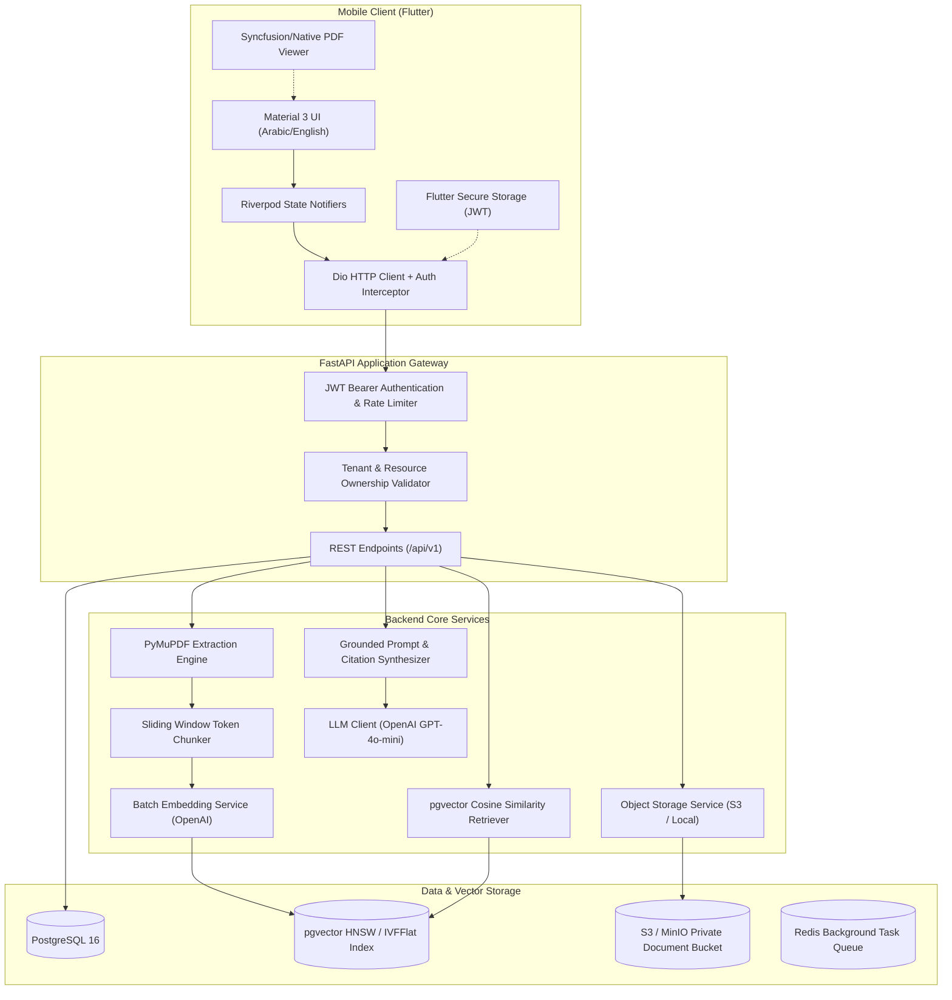

# AI PDF Assistant — System Architecture & Design Specification

## 1. High-Level System Overview

AI PDF Assistant is an enterprise-grade, privacy-first mobile & AI system allowing users to ingest PDF documents, perform semantic search over dense text, and conduct conversational retrieval with verified, page-level citations.



---

## 2. Component Architecture Breakdown

### 2.1 Mobile Application (Flutter & Dart)
- **Architecture Pattern**: Feature-Driven Clean Architecture.
  - `presentation`: UI widgets, controllers, and Riverpod StateNotifiers.
  - `domain`: Pure business models, value objects, and repository interfaces.
  - `data`: DTOs, data sources (Dio REST API, local storage), and repository implementations.
- **State Management**: `flutter_riverpod` (v2.x) with code generation / async notifiers.
- **Networking**: `dio` with custom interceptors for JWT injection, 401 token refresh/logout, and structured error mapping.
- **PDF Viewing**: Dedicated page-jump controller enabling instant jump to cited pages (`jumpToPage(pageNumber)`).
- **Internationalization (i18n)**: English (LTR) and Arabic (RTL) localization with native typography and directional layout mirroring.

### 2.2 Backend Gateway & Application Services (FastAPI & Python 3.12)
- **Async Framework**: FastAPI utilizing Python 3.12 async/await paradigms.
- **ORM & Data Layer**: SQLAlchemy 2.0 with `asyncpg` driver for non-blocking I/O.
- **Data Validation**: Pydantic v2 schemas for strict input/output DTO parsing and documentation generation.
- **Migrations**: Alembic with auto-generation and schema versioning.
- **Background Task Execution**: Dual-mode worker architecture:
  1. *Development / Simple Mode*: FastAPI `BackgroundTasks` for lightweight local development.
  2. *Production / Distributed Mode*: Celery with Redis broker for scalable, resilient worker pools.

### 2.3 Storage Architecture
- **Raw Document Files**: Stored in private, non-public object storage (AWS S3 or MinIO). Objects are keyed by `tenant_id/document_id/original_filename`. Download and viewing utilize time-limited pre-signed URLs or stream proxies with ownership validation.
- **Relational Metadata**: Users, document metadata, processing logs, conversations, and message histories reside in PostgreSQL.
- **Vector Embeddings**: Dense vector representations (`1536` dimensions for OpenAI `text-embedding-3-small`) stored directly alongside text chunks using the `pgvector` extension.

---

## 3. Directory Layout Specification

```
pdf-assist/
├── docker-compose.yml             # Local multi-service infrastructure
├── .env.example                   # Environment configuration template
├── README.md                      # Engineering portfolio documentation
├── docs/                          # Architectural specs & contracts
│   ├── architecture.md
│   ├── database_schema.md
│   ├── api_contracts.md
│   ├── rag_pipeline.md
│   └── security_model.md
├── backend/                       # Python FastAPI Backend
│   ├── app/
│   │   ├── main.py                # FastAPI factory & lifespan
│   │   ├── core/                  # Security, config, DB session, logger
│   │   ├── models/                # SQLAlchemy ORM models
│   │   ├── schemas/               # Pydantic request/response models
│   │   ├── api/v1/                # Route handlers grouped by resource
│   │   └── services/              # PDF parsing, chunking, embeddings, RAG
│   ├── tests/                     # Pytest suite
│   ├── alembic/                   # Database migrations
│   ├── requirements.txt
│   └── Dockerfile
├── mobile/                        # Flutter Mobile Client
│   ├── lib/
│   │   ├── main.dart
│   │   ├── core/                  # Theme, Dio client, secure storage, i18n
│   │   └── features/              # Feature modules (auth, docs, chat, viewer)
│   ├── pubspec.yaml
│   └── test/
└── web/                           # Companion Web Prototype (Preserved)
    ├── index.html
    ├── css/
    ├── js/
    └── assets/
```
