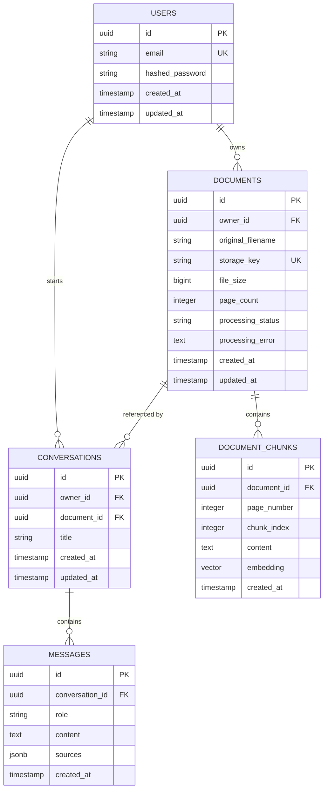

# AI PDF Assistant — Database Schema & Data Modeling

## 1. Entity-Relationship (ER) Diagram



---

## 2. Table Specifications & Constraints

### 2.1 Table: `users`
Represents application accounts with credentials and tenancy scope.
```sql
CREATE TABLE users (
    id UUID PRIMARY KEY DEFAULT gen_random_uuid(),
    email VARCHAR(255) NOT NULL UNIQUE,
    hashed_password VARCHAR(255) NOT NULL,
    created_at TIMESTAMPTZ NOT NULL DEFAULT CURRENT_TIMESTAMP,
    updated_at TIMESTAMPTZ NOT NULL DEFAULT CURRENT_TIMESTAMP
);

CREATE INDEX idx_users_email ON users(email);
```

### 2.2 Table: `documents`
Represents uploaded PDF files and tracks their background processing lifecycle.
```sql
CREATE TYPE processing_status_enum AS ENUM ('uploading', 'processing', 'ready', 'failed');

CREATE TABLE documents (
    id UUID PRIMARY KEY DEFAULT gen_random_uuid(),
    owner_id UUID NOT NULL REFERENCES users(id) ON DELETE CASCADE,
    original_filename VARCHAR(255) NOT NULL,
    storage_key VARCHAR(512) NOT NULL UNIQUE,
    file_size BIGINT NOT NULL,
    page_count INTEGER NOT NULL DEFAULT 0,
    processing_status processing_status_enum NOT NULL DEFAULT 'uploading',
    processing_error TEXT,
    created_at TIMESTAMPTZ NOT NULL DEFAULT CURRENT_TIMESTAMP,
    updated_at TIMESTAMPTZ NOT NULL DEFAULT CURRENT_TIMESTAMP
);

CREATE INDEX idx_documents_owner_id ON documents(owner_id);
CREATE INDEX idx_documents_status ON documents(processing_status);
```

### 2.3 Table: `document_chunks`
Stores discrete, overlapping text chunks with exact 1-based PDF page numbers and vector embeddings.
```sql
CREATE EXTENSION IF NOT EXISTS vector;

CREATE TABLE document_chunks (
    id UUID PRIMARY KEY DEFAULT gen_random_uuid(),
    document_id UUID NOT NULL REFERENCES documents(id) ON DELETE CASCADE,
    page_number INTEGER NOT NULL CHECK (page_number > 0),
    chunk_index INTEGER NOT NULL CHECK (chunk_index >= 0),
    content TEXT NOT NULL,
    embedding VECTOR(1536) NOT NULL,
    created_at TIMESTAMPTZ NOT NULL DEFAULT CURRENT_TIMESTAMP
);

CREATE INDEX idx_chunks_document_id ON document_chunks(document_id);
CREATE INDEX idx_chunks_doc_page ON document_chunks(document_id, page_number);

-- HNSW Vector Index for Cosine Similarity Search (<=> operator)
CREATE INDEX idx_chunks_embedding_hnsw ON document_chunks 
USING hnsw (embedding vector_cosine_ops)
WITH (m = 16, ef_construction = 64);
```

### 2.4 Table: `conversations`
Tracks discussion sessions attached to a specific PDF document.
```sql
CREATE TABLE conversations (
    id UUID PRIMARY KEY DEFAULT gen_random_uuid(),
    owner_id UUID NOT NULL REFERENCES users(id) ON DELETE CASCADE,
    document_id UUID NOT NULL REFERENCES documents(id) ON DELETE CASCADE,
    title VARCHAR(255) NOT NULL DEFAULT 'New Conversation',
    created_at TIMESTAMPTZ NOT NULL DEFAULT CURRENT_TIMESTAMP,
    updated_at TIMESTAMPTZ NOT NULL DEFAULT CURRENT_TIMESTAMP
);

CREATE INDEX idx_conversations_owner_id ON conversations(owner_id);
CREATE INDEX idx_conversations_document_id ON conversations(document_id);
```

### 2.5 Table: `messages`
Stores user questions and assistant responses with verified citation payloads.
```sql
CREATE TYPE message_role_enum AS ENUM ('user', 'assistant');

CREATE TABLE messages (
    id UUID PRIMARY KEY DEFAULT gen_random_uuid(),
    conversation_id UUID NOT NULL REFERENCES conversations(id) ON DELETE CASCADE,
    role message_role_enum NOT NULL,
    content TEXT NOT NULL,
    sources JSONB DEFAULT '[]'::jsonb,
    created_at TIMESTAMPTZ NOT NULL DEFAULT CURRENT_TIMESTAMP
);

CREATE INDEX idx_messages_conversation_id ON messages(conversation_id, created_at ASC);
```

---

## 3. Row-Level Ownership & Vector Isolation Pattern

To prevent cross-tenant data leakage, vector queries are **strictly joined with the document ownership predicate**:

```sql
SELECT 
    c.id AS chunk_id,
    c.page_number,
    c.content,
    1 - (c.embedding <=> :query_embedding) AS similarity_score
FROM document_chunks c
JOIN documents d ON c.document_id = d.id
WHERE d.id = :document_id
  AND d.owner_id = :authenticated_user_id
  AND (1 - (c.embedding <=> :query_embedding)) >= :similarity_threshold
ORDER BY c.embedding <=> :query_embedding ASC
LIMIT :top_k;
```
This guarantees an attacker cannot retrieve chunks from another user's document even if they guess a `chunk_id` or vector parameters.
