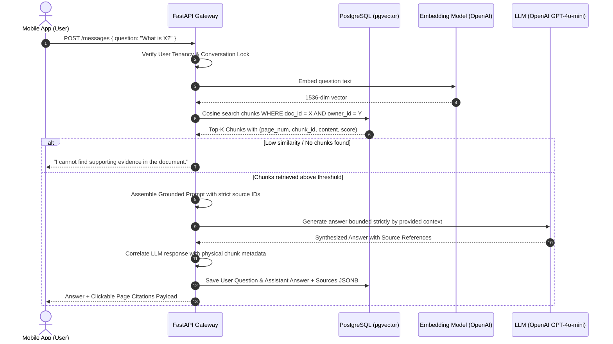

# AI PDF Assistant — RAG Pipeline & Citation Architecture

## 1. End-to-End RAG Lifecycle



---

## 2. Ingestion & Chunking Specification

### 2.1 PyMuPDF Text Extraction & OCR Detection
1. Iterate through document pages using PyMuPDF (`fitz.open(stream)`).
2. Extract text per page: `page.get_text("text")`.
3. Track the **1-based page index**: `page_number = page.number + 1`.
4. **Scanned PDF & OCR Detection Guard**:
   - If total extracted characters across all pages `< 50 * total_pages` and images exist:
   - Flag status as `failed` with error message:
     `"Document appears to be scanned or contains non-extractable raster text. OCR is required."`
   - This prevents silent failure or empty chunk hallucination.

### 2.2 Token-Aware Sliding Window Chunking
- **Chunk Size**: 500 tokens (~2,000 characters).
- **Chunk Overlap**: 100 tokens (~400 characters).
- **Page Boundary Integrity**:
  - Chunks never bleed across unrelated pages without tracking both pages.
  - Each chunk preserves:
    - `document_id`: UUID
    - `page_number`: 1-based integer
    - `chunk_index`: 0-based sequential counter within the page/document
    - `content`: Extracted text snippet

---

## 3. Strict Citation Verification Strategy

### The Hallucination Problem
LLMs frequently hallucinate page numbers (e.g., claiming an excerpt is on page 4 when it actually appears on page 12).

### The Solution: Deterministic Source Mapping
1. **Never let the LLM invent page citations**:
   - The LLM is provided with numbered context blocks:
     ```
     [CONTEXT_BLOCK_1] (Ref ID: chunk-uuid-1)
     "Consolidated operating revenue for Q4 reached $48.2M..."

     [CONTEXT_BLOCK_2] (Ref ID: chunk-uuid-2)
     "Gross margin expanded by 240 basis points..."
     ```
2. **Prompt Instruction**:
   - The LLM is strictly instructed:
     *"Answer the user's question using ONLY the facts from the CONTEXT_BLOCKs provided. For each statement, cite the corresponding Ref ID. If the answer cannot be answered from the text, state that the document does not contain this information."*
3. **Backend Citation Synthesis**:
   - The backend matches the cited `Ref IDs` back to the actual database records:
     ```python
     source_citations = [
         Citation(
             document_id=chunk.document_id,
             page_number=chunk.page_number,  # Physical page stored in DB
             chunk_id=chunk.id,
             excerpt=chunk.content[:200]
         )
         for chunk in retrieved_chunks
     ]
     ```
4. **Mobile Navigation**:
   - Tapping the citation bubble in Flutter invokes:
     `pdfViewerController.jumpToPage(citation.pageNumber);`
